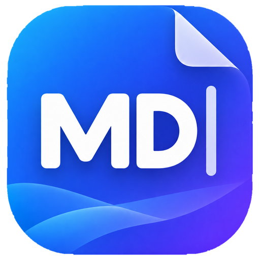

<div align="center">



# MD Show

**A fast, lightweight, offline Markdown viewer and editor for Windows 11.**

Read, edit and preview Markdown in a native Windows window — without a cloud account, document uploads or a bundled browser engine.

[**Download MD Show 1.0**](https://github.com/MonolitVladimir/MDShow/releases) · [**Русский**](README_RU.md) · [Deutsch](README_DE.md) · [العربية](README_AR.md) · [简体中文](README_ZH-CN.md)

</div>

## What you can do

- **Read, edit, or split:** source editing and live Markdown preview, with multiple tabs, an outline and recent files.
- **Write comfortably:** formatting tools, list continuation, search and replace, undo/redo, document zoom and light/dark/system themes.
- **Use familiar Markdown:** GitHub Flavored Markdown tables, checklists, fenced code and local images.
- **Work across languages:** English, Russian, German, Arabic and Simplified Chinese UI, with support for Unicode and right-to-left text.
- **Keep control of files:** preserve encodings, BOM and line endings; atomic saves, conflict warnings and local draft recovery.
- **Share results:** HTML/PDF export and printing.

The application works locally. There is no telemetry, automatic updater, account requirement, Electron, or bundled WebView2 runtime.

## Download and install

Get the files from [GitHub Releases](https://github.com/MonolitVladimir/MDShow/releases). There are three Windows x64 packages:

| File | What it includes |
| --- | --- |
| `MDShow-1.0-Setup-x64.exe` | Installer; five UI languages; Windows **Open with** / Default apps registration |
| `MDShow-1.0-portable-x64.zip` | Five-language portable edition; extract the full archive and run `MDShow.exe` |
| `MDShow-1.0-portable-en-x64.zip` | Portable edition with an English-only interface; supports the same Unicode documents |

**System requirements:** Windows 11 x64, .NET Framework 4.8 and an installed Microsoft Edge WebView2 Evergreen Runtime. Installation requires administrator approval; the portable editions do not install or register file associations. Windows 10 is not a supported target.

**Note:** the EXE files and installer are **not digitally signed**. Verify downloaded release assets against the accompanying `SHA256SUMS.txt`. Windows may display an unknown-publisher warning; do not disable Windows security protections.

## Quick start

Open a `.md` file using **File → Open** or select MD Show in Windows **Open with** (installed edition). Switch between editor, split view and reading mode with `Ctrl+1`, `Ctrl+2`, `Ctrl+3`. Use `Ctrl+F` to search, `Ctrl+S` to save and `F1` for keyboard shortcuts.

Detailed guides: [English](README_EN.md) · [Русский](README_RU.md) · [Deutsch](README_DE.md) · [العربية](README_AR.md) · [简体中文](README_ZH-CN.md).

## Files, privacy and limitations

Documents are processed locally; external images are blocked. Profiles are stored separately in `%LOCALAPPDATA%\MDShow` for Installed, PortableFull and PortableEnglish. Portable does **not** mean a profile next to the EXE. Settings, recent paths and recovery drafts are not encrypted; make your own backups.

The file size limit is **16 MiB**. Preview has additional input (1 million characters), complexity and rendering limits. Very large documents, especially those with many short lines, may make editing temporarily unresponsive. Mermaid, LaTeX and plugins are not included. See [release notes](RELEASE-NOTES-v1.0.md) and [security information](SECURITY.md).

When uninstalling, close MD Show in every Windows session and save your drafts. Uninstall removes the installed application and, when the current user's identity can be safely verified, that user's Installed profile. Saved Markdown files, portable profiles and other users' profiles are preserved.

## Build from source

The native host uses **C# / WinForms / .NET Framework 4.8** and the system WebView2 runtime. No Node.js installation is required to run or build the application.

On Windows 11 with PowerShell 7 and the required build tools:

```powershell
pwsh -File scripts/bootstrap.ps1 -Installer
pwsh -File scripts/build.ps1 -Installer
```

The build downloads pinned dependencies with checksum verification. Build outputs are not guaranteed to be bit-for-bit reproducible.

## License and credits

Original source code and documentation: [MIT License](LICENSE). Artwork and branding have [separate terms](BRANDING.md); third-party libraries retain [their own licenses](THIRD-PARTY-NOTICES.txt).

Developed by **ООО «Агентство «МОНОЛИТ»** (displayed in English as **MONOLIT Agency LLC**). The repository is maintained under the developer's personal GitHub account. [Ownership details](COPYRIGHT.md).

For security reports, see [SECURITY.md](SECURITY.md); please do not disclose vulnerabilities or private documents in public issues.
