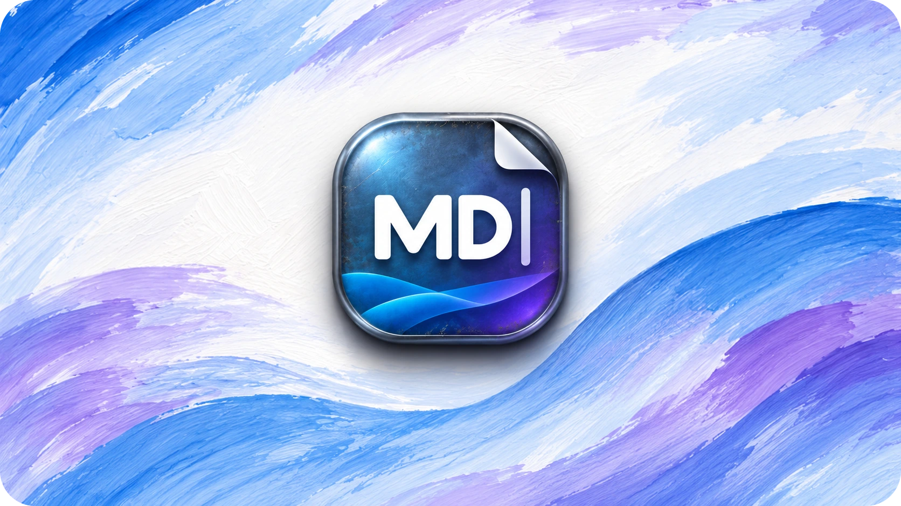

<p align="center">
  
</p>

<div align="center">

# MD Show

**Markdown, without the overhead.**

A fast, lightweight Markdown viewer and editor for Windows 11.  
Read, write and preview your documents in one desktop app — privately, offline and without an account.

[**Download v1.0.0**](https://github.com/MonolitVladimir/MDShow/releases/tag/v1.0.0) · [Release notes](RELEASE-NOTES-v1.0.md) · [Source code](https://github.com/MonolitVladimir/MDShow)

**Windows 11 x64** · **Five UI languages** · **No telemetry** · **MIT-licensed source**

[English](README_EN.md) · [Русский](README_RU.md) · [Deutsch](README_DE.md) · [العربية](README_AR.md) · [简体中文](README_ZH-CN.md)

</div>

---

## A comfortable home for Markdown

| Read | Edit | Preview |
| :--- | :--- | :--- |
| Clean reading mode, document outline and multiple tabs. | Source editing, formatting tools, search and replace, undo and redo. | Live split view, GitHub Flavored Markdown, local images, HTML/PDF export and printing. |

### Built for everyday files

- **Fast to open.** A compact native Windows host, with an optimized startup path and the system WebView2 runtime instead of a bundled browser engine.
- **Your documents stay yours.** No cloud account, telemetry, automatic upload or sync service.
- **Made for real text.** Unicode documents, encoding/BOM and line-ending preservation, atomic saves, conflict warnings and local draft recovery.
- **Work your way.** Light, dark and system themes, document zoom, tabs, recent files and keyboard shortcuts.
- **Five interface languages.** English, Russian, German, Arabic (including right-to-left UI) and Simplified Chinese.

## Download

Choose the edition that fits your workflow. All packages are for **Windows 11 x64**.

| Edition | Download | Details |
| :--- | :--- | :--- |
| **Installer** | [MDShow-1.0-Setup-x64.exe](https://github.com/MonolitVladimir/MDShow/releases/download/v1.0.0/MDShow-1.0-Setup-x64.exe) | Five languages; Windows **Open with** / Default apps integration. Requires administrator approval. |
| **Portable — multilingual** | [MDShow-1.0-portable-x64.zip](https://github.com/MonolitVladimir/MDShow/releases/download/v1.0.0/MDShow-1.0-portable-x64.zip) | Five languages; extract the complete ZIP and launch `MDShow.exe`. |
| **Portable — English** | [MDShow-1.0-portable-en-x64.zip](https://github.com/MonolitVladimir/MDShow/releases/download/v1.0.0/MDShow-1.0-portable-en-x64.zip) | English interface; Unicode documents remain fully supported. |

[**All releases**](https://github.com/MonolitVladimir/MDShow/releases) · [**SHA-256 checksums**](https://github.com/MonolitVladimir/MDShow/releases/download/v1.0.0/SHA256SUMS.txt)

> **Windows security notice:** Version 1.0.0 binaries are **not digitally signed**. Windows may identify the publisher as unknown or show a SmartScreen warning. Verify downloads against `SHA256SUMS.txt`; do not disable Windows security protections.

### Requirements

- Windows 11, 64-bit. Windows 10 is not a supported target.
- .NET Framework 4.8.
- Microsoft Edge **WebView2 Evergreen Runtime** installed on the system (not bundled).

The portable editions do not install the app or register file associations. They keep their profiles in the Windows user-data directory, **not** beside the executable.

## Get started

1. Download the installer or extract a portable archive.
2. Open a `.md` file with **File → Open** (or **Open with → MD Show** when using the installed edition).
3. Switch between source, split and reading modes as needed.

| Action | Shortcut |
| :--- | :--- |
| Open / create document | `Ctrl+O` / `Ctrl+N` |
| Save / Save As | `Ctrl+S` / `Ctrl+Shift+S` |
| Editor / Split / Reading mode | `Ctrl+1` / `Ctrl+2` / `Ctrl+3` |
| Find / Replace | `Ctrl+F` / `Ctrl+H` |
| Keyboard shortcut help | `F1` |

## Local by design

MD Show processes documents on your computer. It does not require an account, send documents to a server, collect telemetry or automatically update itself. External images are blocked.

Settings, recent-file paths and recovery drafts are stored under `%LOCALAPPDATA%\MDShow` in separate profiles for the installed and two portable editions. These files are **not encrypted**; recovery is not a substitute for backups. See the [security policy](SECURITY.md) for details.

## Known limits

- Maximum supported document size: **16 MiB**. Preview has a separate input limit of **1 million characters** and additional rendering/complexity limits.
- Very large or unusually structured documents can temporarily slow editing.
- Mermaid, LaTeX, remote images and plugins are not supported.
- Some display-scaling, input-method and accessibility configurations have not been manually verified; see the [v1.0.0 release notes](RELEASE-NOTES-v1.0.md).

## Build from source

The Windows host uses **C# / WinForms / .NET Framework 4.8**, with a WebView2-based UI. On Windows 11 with PowerShell 7 and the required Windows build components:

```powershell
pwsh -File scripts/bootstrap.ps1 -Installer
pwsh -File scripts/build.ps1 -Installer
```

The bootstrap script downloads pinned build dependencies and verifies their checksums. Node.js is not required. Build outputs are not guaranteed to be byte-for-byte identical to the release artifacts.

## Documentation and feedback

User guides: [English](README_EN.md) · [Русский](README_RU.md) · [Deutsch](README_DE.md) · [العربية](README_AR.md) · [简体中文](README_ZH-CN.md).

For bugs and feature suggestions, use [GitHub Issues](https://github.com/MonolitVladimir/MDShow/issues). **Security vulnerabilities should be reported privately** through the repository's [security reporting page](https://github.com/MonolitVladimir/MDShow/security), not in public issues.

## License and credits

Original source code and documentation are available under the [MIT License](LICENSE). The MD Show name and artwork have [separate usage terms](BRANDING.md); third-party components retain [their respective licenses](THIRD-PARTY-NOTICES.txt).

Copyright © 2026 **ООО «Агентство «МОНОЛИТ»** (MONOLIT Agency LLC, English display translation).  
Maintained at [MonolitVladimir/MDShow](https://github.com/MonolitVladimir/MDShow). [Ownership details](COPYRIGHT.md).
